# Borrador para la wiki — Reporte de pruebas del Sprint 2

> Se publica en la página **Sprint 2** de la wiki, en "Casos de prueba" y "Pruebas automáticas". Cubre las historias del Sprint 2 ya fusionadas en `main` (#54, #56 y #62).

## 1. Resumen

| Indicador | Resultado |
|---|---|
| Historias cubiertas | HU-11, HU-12, HU-13, HU-14 y HU-15 |
| Casos de prueba diseñados | 23: CP-11.2, CP-11.4, CP-12.1 a CP-12.6, CP-13.1 a CP-13.5, CP-14.1 a CP-14.5 y CP-15.1 a CP-15.5 |
| Ejecución manual de los CP | 21 aprobados (CP-15.2 en parte), 1 bloqueado (CP-13.4) y 1 cubierto solo por pruebas automáticas (CP-13.5) |
| Pruebas automáticas en `main` | **365 ejecutadas, 365 aprobadas, 0 fallidas** (6,5 s) |
| Cobertura de código | **97 %** (1382 sentencias, 48 sin cubrir); mínimo exigido en la CI: 90 % |
| Integración continua | En cada PR hacia `main` corren Ruff, Black, `manage.py check`, las pruebas con cobertura y `pip-audit`. La regla de `main` impide fusionar si fallan |
| Bugs encontrados | 1, de redacción (sección 6) |

## 2. Estrategia de pruebas automáticas

Todas las pruebas usan el proveedor de OCR simulado (`FakeOcrProvider`) y Huey en modo inmediato. No dependen de la red ni de Azure, y cada una cita en su docstring el CP que verifica.

| Funcionalidad | Tipo de prueba | Justificación |
|---|---|---|
| **HU-11** Vista de la página: datos y navegación anterior/siguiente | Integración Django (`TestCase` + `Client`) | Recorre la petición completa y comprueba lo que ve el usuario: datos, enlaces `rel="prev/next"` y saltos de páginas eliminadas |
| **HU-11** Imágenes y miniaturas protegidas (DT-02) | Integración de control de acceso, con `subTest` por dirección | Una sola regla (404 entre cuentas, inicio de sesión sin sesión) se comprueba en las tres direcciones y en la ruta `/media/` |
| **HU-12** Agrupación de líneas y orden de lectura | Unitarias con ejemplos | Algoritmo puro con entradas y salidas exactas |
| **HU-12** Adaptador de Azure AI Vision Read | Integración con la red simulada (`unittest.mock`) | Comprueba el contrato de la API y cada error HTTP sin gastar cuota |
| **HU-12** Procesamiento y estado "Error" | Escenarios, una clase por CP | Cada criterio de aceptación tiene su prueba, incluido el fallo del servicio |
| **HU-13** Reglas de revisión: umbral, texto vacío y alfabeto | Unitarias (`SimpleTestCase`) | Lógica pura y barata de probar con muchos ejemplos de cada alfabeto |
| **HU-13** Texto y confianza guardados por región | Escenarios con el proveedor simulado | El simulado devuelve confianzas exactas, así que se prueba justo por encima y por debajo del 70 % |
| **HU-13** Comando de precisión `ocr_accuracy_report` | Integración del comando con datos sintéticos | CA-13.4 depende del juego de páginas del PO; el comando queda probado y listo |
| **HU-14** Vista dividida, filtro "Por revisar" y página sin procesar | Integración de plantillas (`assertContains`) | Verifica el HTML que recibe el usuario: orden, tipo, confianza y marcas de revisión |
| **HU-14** Selección enlazada y uso con teclado | Contrato de marcado (anclas, `data-region`, `aria-label`) + ejecución manual | Funciona sin JavaScript gracias a las anclas; el resaltado con JavaScript y el foco visible se verifican a mano (sección 5) |
| **HU-15** Corregir, restaurar y región vacía | Escenarios por vista + unitarias del servicio `albums/corrections.py` | Cubre lo guardado y el cambio de estado de la página |
| **HU-15** Aislamiento: región de otra cuenta | Integración de control de acceso | Responde 404 y la región no cambia |

Todas las funcionalidades tienen al menos una prueba de *happy path* y otra de flujo alternativo, como pide el documento del Sprint 2.

## 3. Resultados de las pruebas automáticas

Ejecución del 21/10/2026 sobre `main` (commit `00bd938`), con `coverage run manage.py test -v 2`: **365 pruebas, 0 fallos**.

| CP | Pruebas automáticas | Resultado |
|---|---|---|
| CP-11.2 Seleccionar una página | 6 | ✅ Todas aprobadas |
| CP-11.4 Imágenes de otra cuenta | 9 | ✅ |
| CP-12.1 Procesar una página | 21 | ✅ |
| CP-12.2 Regiones en orden de lectura | 11 | ✅ |
| CP-12.3 Página sin texto | 4 | ✅ |
| CP-12.4 Falla el servicio | 11 | ✅ |
| CP-12.5 Volver a procesar | 4 | ✅ |
| CP-12.6 Solo páginas propias | 4 | ✅ |
| CP-13.1 Texto y confianza por región | 3 | ✅ |
| CP-13.2 Texto en otro alfabeto | 6 | ✅ |
| CP-13.3 Región con baja confianza | 6 | ✅ |
| CP-13.4 Precisión mínima por idioma | 7 (del comando) | ✅ |
| CP-13.5 Falla el OCR en una región | 2 | ✅ |
| CP-14.1 Vista dividida | 2 | ✅ |
| CP-14.2 Relacionar región y texto | 2 | ✅ |
| CP-14.3 Destacar lo que hay que revisar | 3 | ✅ |
| CP-14.4 Página sin procesar | 1 | ✅ |
| CP-14.5 Teclado y lector de pantalla | 2 | ✅ |
| CP-15.1 Corregir una región | 5 | ✅ |
| CP-15.2 La traducción usa la corrección | 1 | ✅ |
| CP-15.3 Restaurar el texto del OCR | 2 | ✅ |
| CP-15.4 Salir con cambios sin guardar | 2 | ✅ |
| CP-15.5 Dejar vacía una región | 1 | ✅ |

El resto de las 365 son del Sprint 1 (HU-01 a HU-10, HU-49 y HU-50) y de comprobaciones transversales: rutas privadas, higiene de plantillas y sistema de diseño. Todas siguen en verde.

## 4. Cobertura de código

Medida con coverage.py sobre `accounts`, `albums` y `config`. Excluye migraciones, pruebas y los puntos de arranque `asgi.py` y `wsgi.py`, que solo inician el servidor. La configuración está en `pyproject.toml`. La CI publica el resumen en cada PR, adjunta el reporte HTML como artefacto y **falla si la cobertura baja del 90 %**.

| Módulo | Sentencias | Sin cubrir | Cobertura |
|---|---|---|---|
| **Total** | **1382** | **48** | **97 %** |
| `albums/validators.py` | 52 | 8 | 85 % |
| `albums/signals.py` | 21 | 2 | 90 % |
| `albums/views.py` | 231 | 11 | 95 % |
| `albums/models.py` | 196 | 3 | 98 % |
| `albums/processing.py`, `services.py`, `ocr/fake.py`, `ocr/review.py`, `tasks.py` | — | 0 | 100 % |
| Otros 18 archivos | — | 0 | 100 % |

Lo que queda sin cubrir son sobre todo ramas defensivas: errores de Pillow con archivos corruptos poco comunes en `validators.py`, o fallos al borrar un archivo que ya no existe en `signals.py`.

## 5. Ejecución de los casos de prueba

**Entorno:**
- Copia limpia de `main` (commit `00bd938`), Django en `localhost:8002` y trabajador de Huey.
- **Azure AI Vision Read real** (plan F0, región westus).
- Navegador Chromium a 1440 × 900.

**Datos:** dos cuentas de prueba (la propia y una ajena) con:
- un álbum japonés de 3 páginas, una de ellas en blanco;
- un álbum japonés con dos páginas reales de manga que había subido el equipo: una página de *Naruto* (355 × 563 px) y una comparación con el original japonés y la traducción inglesa lado a lado;
- un álbum en inglés;
- un álbum marcado como japonés con una página en inglés, para el caso de alfabeto equivocado;
- un álbum de la cuenta ajena.

**Fecha:** 21/10/2026.

| CP | Resultado | Lo observado |
|---|---|---|
| CP-11.2 | ✅ Aprobada | Página 2 de 3: número, archivo original, 800 × 1130 px, 7,4 KB, "Pendiente de procesamiento" y fecha de carga. "Anterior" y "Siguiente" enlazan a las páginas 1 y 3; la flecha → del teclado pasa a la página 3 |
| CP-11.4 | ✅ Aprobada | Con sesión, la vista, la imagen y la miniatura de la página ajena responden 404, igual que su ruta directa en `/media/`. Sin sesión, las tres redirigen a iniciar sesión y no entregan la imagen |
| CP-12.1 | ✅ Aprobada | "Procesar página" → la página pasa a "Procesando" y, sin recargar a mano, a "Procesada" |
| CP-12.2 | ✅ Aprobada | Página de prueba: 2 regiones en orden japonés (de derecha a izquierda). Página real de *Naruto*: 10 regiones numeradas de derecha a izquierda y de arriba abajo, viñeta por viñeta |
| CP-12.3 | ✅ Aprobada | La página en blanco queda "Procesada", con 0 regiones y "No se detectó texto en esta página." |
| CP-12.4 | ✅ Aprobada | Ocurrió de verdad: el trabajador no tenía red. La página pasó a "Error" con "El servicio de detección de texto no está disponible." y el botón "Reintentar"; al reintentar con red, se procesó bien. Se reprodujo después con una dirección de Azure inexistente, con el mismo resultado |
| CP-12.5 | ✅ Aprobada | "Volver a procesar" pide confirmación y avisa de las 2 regiones y de la corrección que se perderán; al confirmar, las regiones se reemplazan. Ver BUG en la sección 6 |
| CP-12.6 | ✅ Aprobada | Pedir procesar o consultar el estado de la página ajena responde 404 y la página sigue "Pendiente" |
| CP-13.1 | ✅ Aprobada | Cada región guarda su texto y su confianza: 99 % en la página de prueba; entre 62 y 97 % en la página real de *Naruto*, más pequeña y con texto a mano. Ver la observación de la sección 6 |
| CP-13.2 | ✅ Aprobada | Página en inglés en un álbum japonés: las 12 regiones quedan marcadas. En la comparación de *Naruto*, las 4 regiones japonesas pasan y las 3 inglesas se marcan "Revisar" aunque tengan 92 a 99 % de confianza |
| CP-13.3 | ✅ Aprobada | Página en inglés: la región 9 (65 %) se marca y las otras 11 (91 a 98 %) no. Página de *Naruto*: se marcan las regiones 5, 7 y 10 (64 %, 62 % y 65 %) y la región 6, que solo leyó una "M" sin letras japonesas; la página pasa a "Necesita revisión" |
| CP-13.4 | ⛔ Bloqueada | Falta el juego de páginas de prueba y la precisión mínima que debe fijar el PO. El comando `ocr_accuracy_report` está listo y probado |
| CP-13.5 | 🤖 Solo automática | Azure no permite provocar a mano el fallo de una sola región; se cubre con 2 pruebas automáticas |
| CP-14.1 | ✅ Aprobada | La imagen con sus regiones numeradas y, al lado, el texto de cada una con su tipo ("Globo de diálogo") y su confianza |
| CP-14.2 | ✅ Aprobada | Pulsar una región resalta su texto en la lista y pulsar un texto resalta su región en la imagen, en las páginas de prueba y de *Naruto* |
| CP-14.3 | ✅ Aprobada | Las regiones por revisar tienen borde discontinuo y "!" junto al número, no solo color. El filtro "Por revisar" deja solo las marcadas: 1 en la página en inglés y 4 en la de *Naruto* |
| CP-14.4 | ✅ Aprobada | La página sin procesar muestra "Esta página aún no se ha procesado" y "Procesar página" |
| CP-14.5 | ✅ Aprobada | Con Tab el foco llega a cada región con contorno visible del color de marca; cada región se anuncia con número, tipo, si necesita revisión y su texto |
| CP-15.1 | ✅ Aprobada | Página de prueba: región 1 corregida. Página de *Naruto*: la región 10, que el OCR leyó "パカもの— -E", se corrige a 「バカもの――――!!!」; se ve "Corregida", el texto nuevo y el aviso de guardado |
| CP-15.2 | ✅ Aprobada (parcial) | El texto final de la región, el que usará la traducción, es el corregido; el original del OCR se conserva aparte. La traducción misma llega con HU-16 |
| CP-15.3 | ✅ Aprobada | "Restaurar texto del OCR" vuelve al texto detectado (región 1 de la página de prueba y región 10 de *Naruto*), y la región vuelve a "Revisar" |
| CP-15.4 | ✅ Aprobada | Con una edición sin guardar, el navegador pide confirmación antes de salir de la página |
| CP-15.5 | ✅ Aprobada | Vaciar una región y guardar: queda "Corregida" con "Sin texto que traducir". En *Naruto* se usó la región 6, una "M" suelta sin nada que traducir |

### Evidencias por cada CP

Capturas a 1440 × 900 tomadas el 21/10/2026 sobre la misma copia de `main`, con Azure real.

- **CP-11.2 y CP-14.4** — La página 2 de 3 muestra sus datos (número, archivo original, dimensiones, tamaño, estado y fecha de carga) y los botones "Anterior" y "Siguiente". Como aún no está procesada, el panel dice "Esta página aún no se ha procesado" y ofrece "Procesar página".

  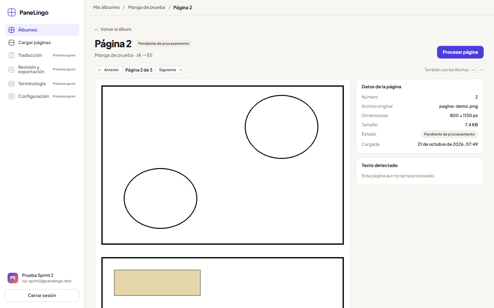

- **CP-11.4 y CP-12.6** — Con la sesión de otra cuenta, la página ajena responde "no encontrada" (404). En desarrollo Django muestra su página técnica; en producción se ve la página de error normal. Pedir su imagen, su miniatura o procesarla da el mismo 404.

  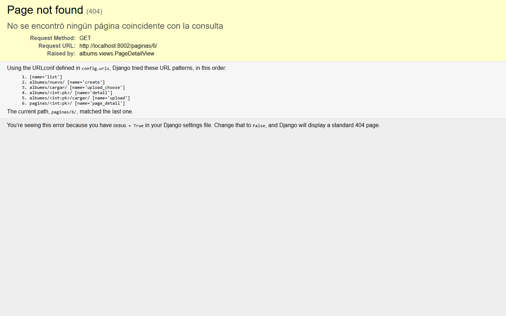

- **CP-12.1** — Al procesar la página de *Naruto*, la página pasa a "Procesando": se ve el aviso de que puede seguir usando PaneLingo y el botón queda deshabilitado. Como es un reproceso, las regiones anteriores siguen a la vista hasta que llegan las nuevas. La vista se actualiza sola al terminar, sin recargar a mano.

  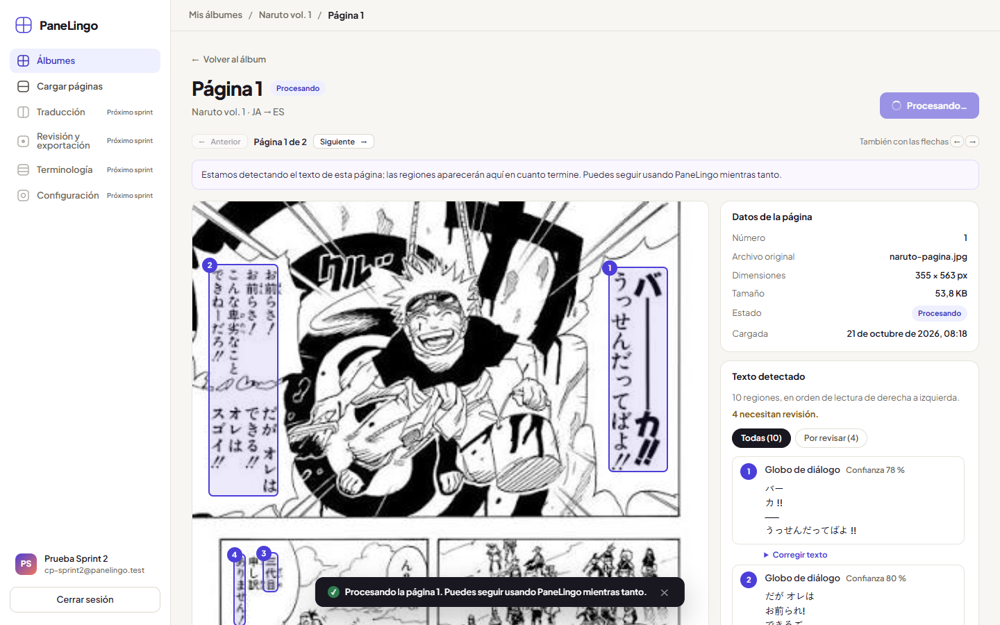

- **CP-12.2, CP-13.1 y CP-14.1** — Página real de *Naruto*:
  - 10 regiones numeradas en orden de lectura japonés: de derecha a izquierda y de arriba abajo, viñeta por viñeta;
  - en el panel, el texto reconocido de cada una con su tipo y su confianza;
  - el resumen indica "4 necesitan revisión".

  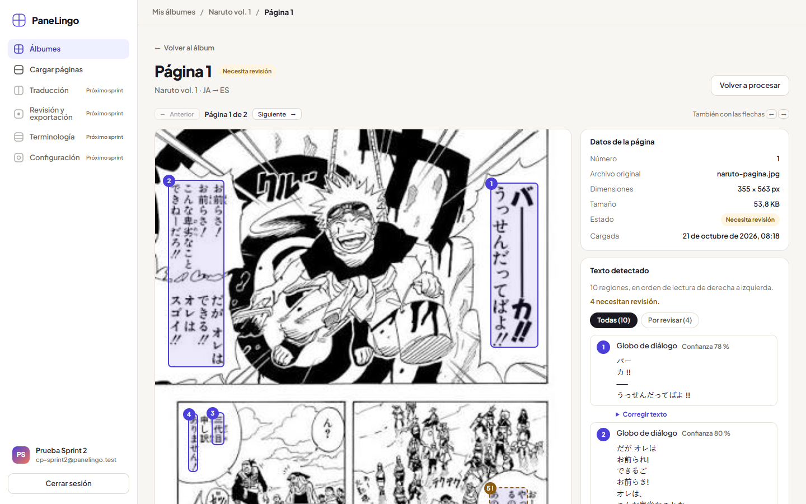

- **CP-12.3** — Una página en blanco queda "Procesada" con el mensaje "No se detectó texto en esta página."

  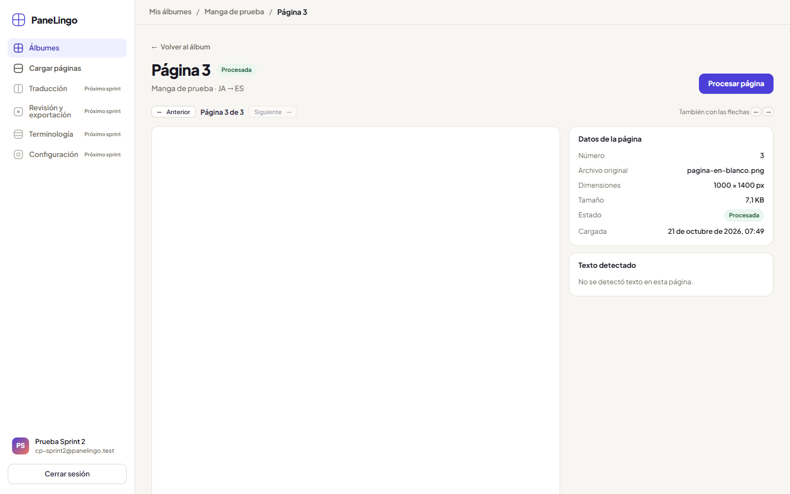

- **CP-12.4** — Con el servicio de detección inalcanzable, la página pasa a "Error". Muestra el motivo ("El servicio de detección de texto no está disponible.") y el botón "Reintentar". Para la captura se reprodujo apuntando el trabajador a una dirección de Azure inexistente; la primera vez ocurrió de forma espontánea, por falta de red.

  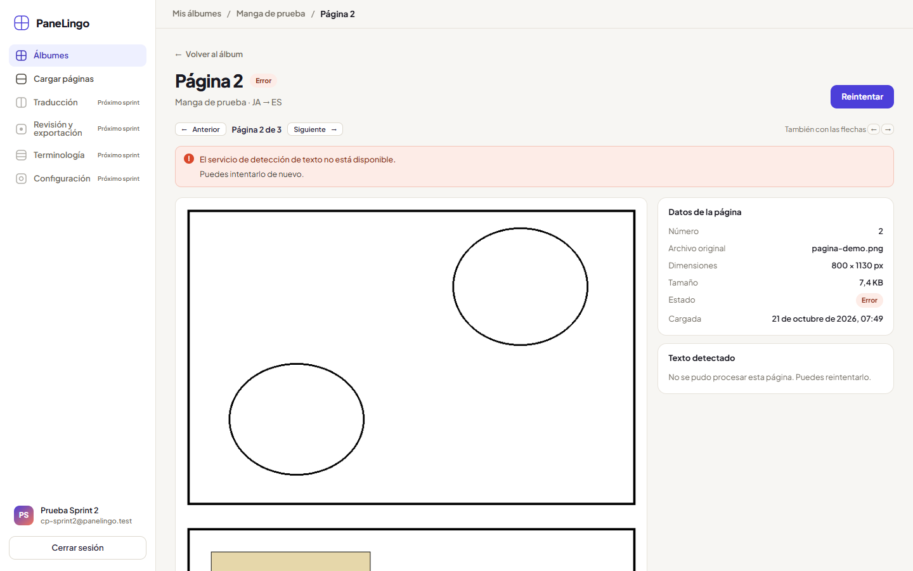

- **CP-12.5** — "Volver a procesar" pide confirmación. Avisa de que se reemplazarán las 10 regiones y de que se perderá la corrección hecha a mano. En el aviso se ve el BUG-063 de la sección 6.

  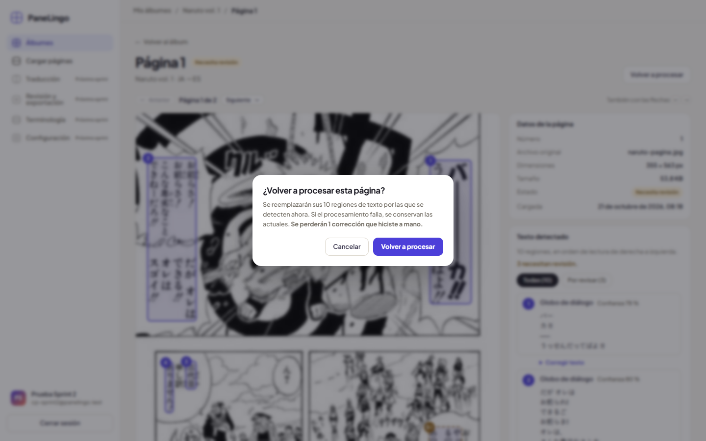

- **CP-13.2** — Comparación de *Naruto* (original japonés y traducción inglesa lado a lado) en un álbum japonés:
  - las regiones japonesas (1, 2, 3 y 6) pasan;
  - las inglesas (4, 5 y 7) se marcan para revisión, con borde discontinuo y "!", aunque su confianza sea alta: el texto no está en el alfabeto del idioma de origen.

  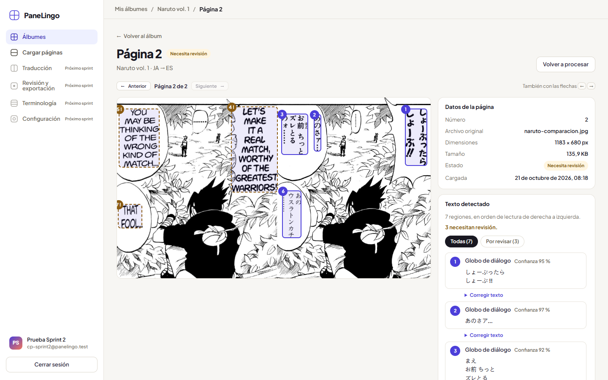

- **CP-13.3 y CP-14.3** — En la página de *Naruto*, con el filtro "Por revisar (4)":
  - quedan solo las regiones marcadas; la primera es la 5, con 65 % de confianza;
  - en la imagen se distinguen por el borde discontinuo y el "!";
  - la página está en "Necesita revisión".

  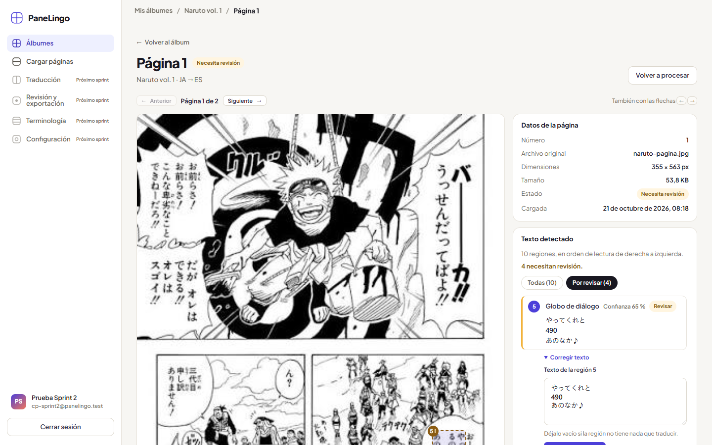

- **CP-14.2** — Al pulsar la región 4 en la imagen, se resalta a la vez su recuadro y su texto en la lista (abajo a la derecha).

  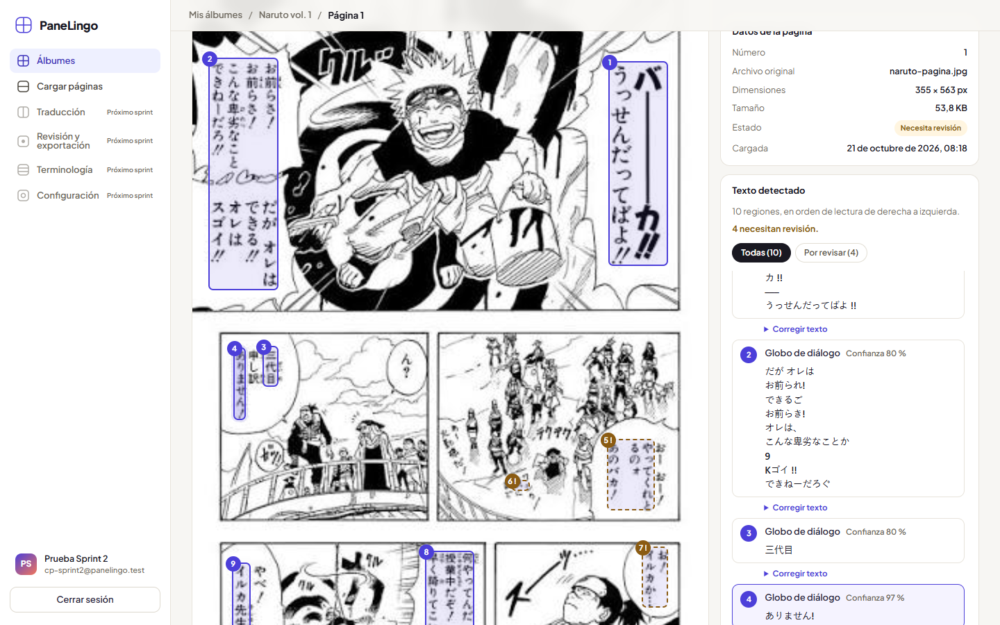

- **CP-14.5** — Con la tecla Tab, el foco llega a la región 1 (arriba a la derecha) y se ve el contorno de foco alrededor de su recuadro. El lector de pantalla anuncia su número, su tipo y su texto.

  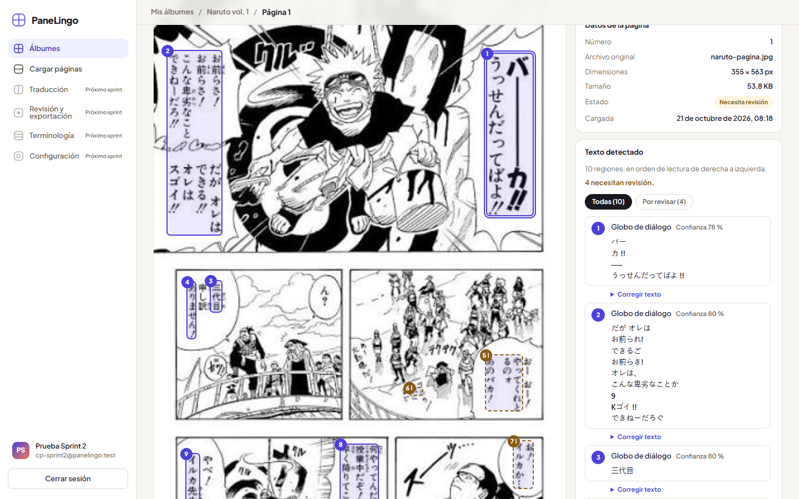

- **CP-15.1** — La región 10, que el OCR leyó mal ("パカもの— -E", 62 %), corregida a 「バカもの――――!!!」. Muestra "Corregida", el texto nuevo y el aviso "Se guardó la corrección de la región 10."

  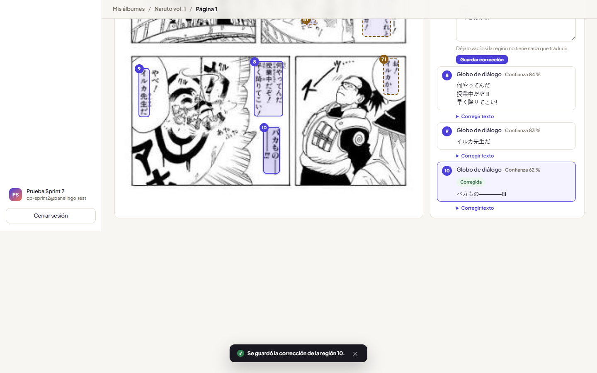

- **CP-15.3** — "Restaurar texto del OCR" devuelve la región 10 al texto detectado. Vuelve a quedar marcada "Revisar" y aparece "Se restauró el texto del OCR de la región 10."

  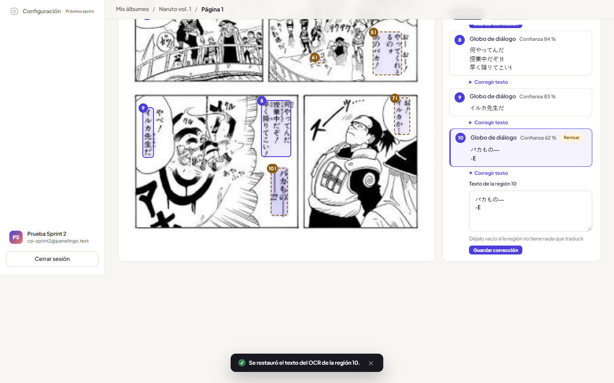

- **CP-15.5** — La región 6 (una "M" suelta, sin nada que traducir) vaciada y guardada queda "Corregida" con "Sin texto que traducir", y la página pasa a 3 regiones por revisar.

  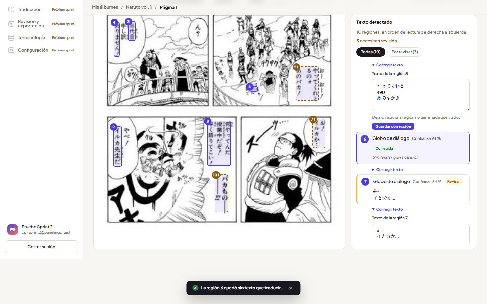

**Sin captura:**
- **CP-15.4:** el aviso de cambios sin guardar es un cuadro del propio navegador y no aparece en una captura de la página.
- **CP-15.2:** se comprueba en la base de datos.
- **CP-13.5:** solo tiene prueba automática.
- **CP-13.4:** está bloqueado.

## 6. Bugs encontrados

| Bug | CP | Descripción | Gravedad | Estado |
|---|---|---|---|---|
| [BUG-063](https://github.com/RestrepoJuanP/PaneLingo/issues/63) — Concordancia en el aviso de reprocesar | CP-12.5 | Con una sola corrección, el aviso dice "Se perderán **1 corrección** que hiciste a mano"; debería decir "Se perderá 1 corrección". Está en `templates/albums/page_detail.html` y la prueba lo da por bueno | Baja: solo redacción, no impide el resultado esperado | Registrado, pendiente de corrección |

### Observaciones (no son bugs)

- **El umbral del 70 % deja pasar texto mal leído.** En la página real de *Naruto* (355 × 563 px, por debajo de la resolución recomendada), Azure unió dos globos cercanos en la región 2 y confundió caracteres. Aun así, devolvió 80 % de confianza, así que la región no se marcó para revisión. Es un dato para que el PO fije el umbral definitivo y el juego de páginas de CA-13.4. Mientras tanto, HU-15 permite corregir la región a mano.
- **La barra lateral no acompaña el desplazamiento en `main`.** Al bajar hasta el final de una página larga, la barra lateral se queda arriba, como se ve en las capturas de CP-15.1 y CP-15.3. Ya estaba reportado y está corregido en la PR #61, pendiente de fusión.

## 7. Cómo reproducir

```bash
pip install -r requirements-dev.txt
coverage run manage.py test
coverage report
```

`coverage html` genera el reporte navegable en `htmlcov/`. En GitHub, cada PR muestra el resumen de cobertura en la pestaña *Checks* y adjunta el HTML como artefacto `cobertura-html`.
